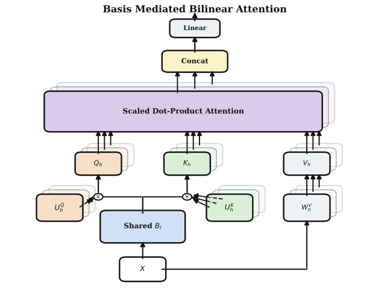
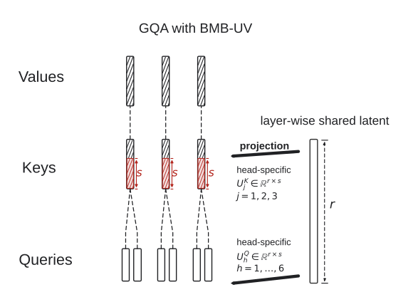

# Basis-Mediated Bilinear Attention

[](https://openreview.net/pdf?id=9mEBiUiVG1)
[](docs/attention_api.md)
[](LICENSE)

**Wei Chen · Yiying Yang · Wenhao Jiang**

Basis-Mediated Bilinear Attention (BMB) shares a latent basis across the attention heads in each layer while retaining head-specific query–key interactions. BMB-UV reparameterizes these interactions to produce explicit Q and K tensors, making the method compatible with standard RoPE, masking, SDPA, grouped-query attention, and KV-cache workflows.

This repository provides a PyTorch Attention API, a complete GQA+BMB-UV language model, and the training and evaluation code for our paper.

## Installation

```bash
git clone https://github.com/CWhhhaaha/Basis-Mediated-Bilinear-Attention.git
cd Basis-Mediated-Bilinear-Attention

# Attention API: PyTorch only
python -m pip install -e .

# Training and evaluation
python -m pip install -e '.[train,eval]'

# Optional FlashAttention-4 backend
python -m pip install -e '.[fa4]'
# CUDA 13 dependency set; FA4 is currently distributed as a pre-release
python -m pip install --pre 'flash-attn-4[cu13]'
```

Install the PyTorch build appropriate for your platform before installing the package. The default attention backend is PyTorch SDPA; FlashAttention-4 is optional.

## Use BMB-UV in a PyTorch model

```python
import torch
from bmb import BMBAttention

attn = BMBAttention(
    d_model=768,
    n_heads=22,
    n_kv_heads=2,
    latent_rank=64,
    factor_rank=32,
    value_dim=64,
).eval()

x = torch.randn(2, 128, 768)
with torch.inference_mode():
    y, cache = attn(x, use_cache=True)  # y: [2,128,768]
    next_x = torch.randn(2, 1, 768)
    y_next, cache = attn(
        next_x, past_key_value=cache, use_cache=True
    )
```

The module contains the shared basis, Q/K factors, V and output projections, grouped attention, RoPE, and cache handling. Add the normalization, residual connection, and MLP in the surrounding Transformer block:

```python
norm = torch.nn.RMSNorm(768)
x = x + attn(norm(x))[0]
```

BMB-UV changes the Q/K parameterization, so a replacement attention layer needs training or fine-tuning.

### Functional API

```python
from bmb import bmb_uv_attention

z = attn.basis(x)                        # [B,T,r]
v = attn.v_proj(x).view(2, 128, 2, 64)  # [B,T,H_kv,d_v]
cos_sin = attn.rotary(x, 0, 128)

y, cache = bmb_uv_attention(
    z, attn.q_factor, attn.k_factor, v,
    cos_sin=cos_sin, use_cache=True,
)                                       # [B,T,H,d_v]
y = attn.o_proj(y.reshape(2, 128, 22 * 64))
```

The lower-level `project_bmb_uv` and `grouped_attention` functions are available for custom position transforms and host-managed caches.

### Integration features

- **Head layouts:** set `n_kv_heads` for MHA, MQA, or GQA-style KV sharing.
- **Position encoding:** use built-in RoPE, supply external `cos_sin`, or disable internal RoPE.
- **Masks:** causal or bidirectional attention, 2D key-padding masks, and boolean or additive 4D masks.
- **Decoding:** dynamic `(K,V)` caches, chunked prefill, and preallocated static caches.
- **Backends:** SDPA by default, a reference implementation for debugging, and an explicit optional FA4 path.

See the [Attention API reference](docs/attention_api.md), [integration guide](docs/integration.md), and the runnable examples in `examples/`.

## Choosing `r` and `s`

`latent_rank` ($r$) controls the shared latent width. `factor_rank` ($s$) controls the Q/K factor width and the explicit key-cache width. A smaller $s$ narrows the cached K tensor; the two ranks are hyperparameters rather than fixed constants.

Our experiments used $(r,s)=(32,32)$ and $(64,64)$ for GPT-2/C4 and ViT/ImageNet-1K, and the following settings for FineWeb-Edu:

| Experiment | Model scale | Training tokens | $(r,s)$ |
|---|---:|---:|---:|
| FineWeb Small | 110.6M | 49.152B | $(64,32)$ |
| FineWeb XL | 1.33B | approximately 49.153B | $(128,32)$ |

The supplied configurations contain the complete model and optimization settings.

## Method



Native BMB computes

$$
Z=XB,\qquad L_h=\frac{ZM_hZ^\top}{\sqrt r},\qquad
O_h=\mathrm{softmax}(L_h)V_h.
$$

BMB-UV reparameterizes the head-specific interaction as $M_h=U_h^Q{U_h^K}^\top$ and materializes explicit Q and K tensors for standard attention interfaces. The mathematical definitions and the eight QK parameter-sharing baselines are documented in [docs/methods.md](docs/methods.md).

### GQA + BMB-UV



GQA reduces the number of KV heads. BMB-UV additionally narrows each cached key when $s<d_k$. For each token and layer, explicit K/V storage contains

$$
H_{kv}(s+d_v)
$$

elements. Caching the shared latent Z together with V would require $r+H_{kv}d_v$ elements and is smaller only when $r<H_{kv}s$. Our XL configuration uses explicit, position-encoded K/V because $r=128$, $H_{kv}=2$, and $s=32$.

## Paper results

Both FineWeb runs process approximately 49.15B tokens. Downstream scores are unweighted means over the nine tasks in the public TPA evaluation protocol.

| Scale | Parameters | Validation CE / PPL | 0-shot | 2-shot |
|---|---:|---:|---:|---:|
| Small, $(r,s)=(64,32)$ | 110.6M | 2.691 / 14.75 | 44.79 | 46.31 |
| XL, $(r,s)=(128,32)$ | 1.33B | 2.473 / 11.86 | 54.42 | 56.34 |

The reported XL GQA reference obtains 54.33 / 56.49 with 1.55B parameters. GQA+BMB-UV uses **14.54% fewer total parameters** and **92.00% fewer Q/K parameters per layer**.

At XL, K+V changes from $64+64=128$ to $32+64=96$ elements per KV head per token, reducing logical KV storage by **25.00%**. Controlled measurements on one RTX 6000D with BF16, batch 1, FA4, and static caches give:

| Measurement | GQA | GQA+BMB-UV |
|---|---:|---:|
| Logical KV at 1M positions | 22.89 GiB | 17.17 GiB |
| 16K prefill | 16.30K tok/s | 20.46K tok/s |
| 16K decode | 34.91 ms/tok | 35.62 ms/tok |
| 1M-cache decode | 1,753.87 ms/tok | 1,334.64 ms/tok |
| Peak allocation at 1M | 25.93 GiB | 19.79 GiB |

The 1M measurement is full-model decoding over a preallocated synthetic cache, not 1M-token prefill. Benchmark code and the measurement protocol are in [docs/evaluation_and_systems.md](docs/evaluation_and_systems.md).

## Training and evaluation

| Study | Configurations | Entry points |
|---|---|---|
| GPT-2/C4 QK comparison | `configs/gpt2_c4.yaml` | `scripts/run_gpt2_c4.sh` |
| ViT/ImageNet-1K QK comparison | `configs/imagenet_main.yaml`, `configs/experiments/` | `scripts/run_imagenet.sh` |
| FineWeb Small/XL and GQA controls | `configs/fineweb_*.json` | `scripts/train_fineweb.sh` |
| Nine-task downstream evaluation | A trained checkpoint | `python -m bmb.evaluate_downstream` |
| Prefill and long-cache decoding | `configs/fineweb_xl.json` | `python -m bmb.benchmark_systems` |

Dataset download and preparation commands are in [docs/data_preparation.md](docs/data_preparation.md). The complete FineWeb recipe is in [docs/tpa_fineweb_recipe.md](docs/tpa_fineweb_recipe.md), and a compact reproduction guide is in [docs/reproducibility.md](docs/reproducibility.md).

## Tests

Run the standalone Attention tests with PyTorch:

```bash
PYTHONPATH=src python -m unittest \
  tests.test_attention tests.test_plug_and_play_attention \
  tests.test_functional_api tests.test_fa4_backend -v
```

Install the test and training extras for the complete suite:

```bash
python -m pip install -e '.[train,test]'
PYTHONPATH=src python -m pytest -q
```

The tests cover module/functional equivalence, masks, RoPE, forward/backward, chunked prefill, incremental decoding, dynamic/static caches, GPT-2 integration, and real cached `generate()` calls. FA4 unit tests use a mocked entry point; run the systems benchmark to exercise FA4 on a target GPU.

## Citation

```bibtex
@inproceedings{chen2026bmb,
  title     = {Basis-Mediated Bilinear Attention: A New Method for Greatly Reducing Query--Key Pathway Parameters},
  author    = {Chen, Wei and Yang, Yiying and Jiang, Wenhao},
  booktitle = {Advances in Neural Information Processing Systems},
  year      = {2026},
  note      = {Spotlight}
}
```
